<div align="center">

<a href="https://parkdohyun.com"></a>

[](https://parkdohyun.com) [](https://linkedin.com/in/dohyunbak) [](https://parkdohyun.tistory.com/) [](https://www.youtube.com/@Mr.Share_Man) [](mailto:badberg2002@gmail.com)

**[Direction](#direction)** · [Pipelines](#one-shape-four-systems) · [U-sto](#u-sto) · [W브릿지](#w브릿지) · [DOVIS](#dovis) · [Kids Friends](#kids-friends) · [DOVERVE](#doverve) · [How I Build](#how-i-build) · [Principles](#engineering-principles) · [Stack](#tech-stack)

</div>

사용자가 반복해서 겪는 문제에서 출발해 제품을 만들고, AI는 검증 가능한 작업 도구로 붙입니다. LLM 결과를 맹신하지 않고 파싱·검증·추적 가능한 구조로 만들며, 실패 경로를 기능과 함께 설계합니다.

<table>
  <tr><td width="84"><b>지금</b></td><td>한양대학교 ICT융합학부 졸업예정 (2027.03)</td></tr>
  <tr><td width="84"><b>경력</b></td><td>Qantum Edu Solution · Solution Development Intern (2026.06 – 2026.08)</td></tr>
  <tr><td width="84"><b>주력</b></td><td>Java · Spring Boot · MySQL · LLM Pipeline</td></tr>
  <tr><td width="84"><b>자격</b></td><td>SQLD · ADsP · 컴퓨터활용능력 2급</td></tr>
</table>

## Direction

| 방향 | 해 온 일 | 프로젝트 |
|---|---|---|
| **AX Engineer** | 기존 시스템에 AI를 붙이고, 검증한 결과를 업무 흐름에 넣었습니다 | [W브릿지](#w브릿지) · [U-sto](#u-sto) |
| **Product Engineer** | 사용자 문제를 먼저 정의하고, 그 문제를 푸는 기능을 구현했습니다 | [DOVERVE](#doverve) · [Kids Friends](#kids-friends) |
| **Product Builder** | 직접 기획하고 구현해 웹에 공개했습니다 | [DOVIS](#dovis) · [DOVERVE](#doverve) |

## One Shape, Four Systems

도메인은 달라도 설계 모양은 같습니다. 입력을 경계에서 걸러 핵심 처리로 넘기고, 실패와 이력은 다른 길로 보냅니다.

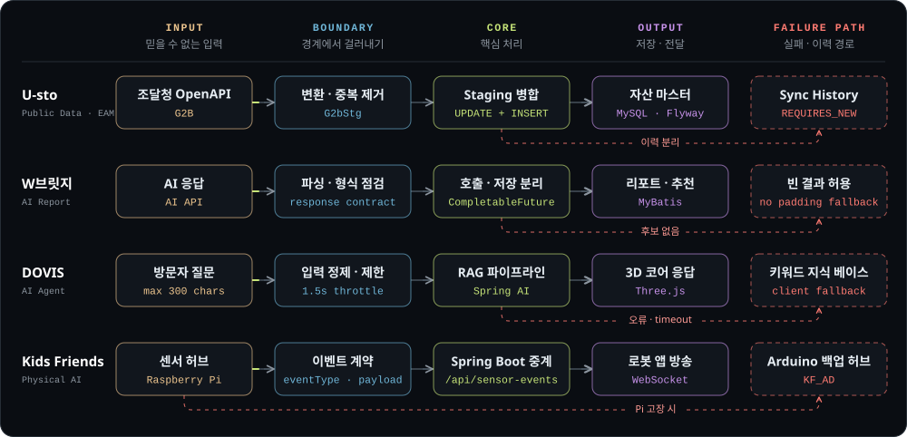

<details>
<summary>표로 보기</summary>

| System | Input | Boundary | Core | Output | Failure path |
|---|---|---|---|---|---|
| U-sto | 조달청 OpenAPI | 도메인 변환, 중복 제거 | Staging 병합 | 자산 마스터 (MySQL) | Sync History (`REQUIRES_NEW`) |
| W브릿지 | AI 응답 | 파싱, 형식 점검 | 호출과 저장 분리 | 리포트, 추천 (MyBatis) | 후보가 없으면 빈 결과 |
| DOVIS | 방문자 질문 | 입력 정제, 1.5초 제한 | RAG 파이프라인 | 3D 코어 응답 | 클라이언트 키워드 지식 베이스 |
| Kids Friends | 센서 허브 | 이벤트 계약 | Spring Boot 중계 | WebSocket 방송 | Arduino 백업 허브 |

</details>

아래 다이어그램도 같은 색을 씁니다. 노랑은 입력, 파랑은 경계, 초록은 핵심 처리, 보라는 저장·전달, 빨간 점선은 실패 경로입니다.

## Architecture

### U-sto

*대학 자산 관리 시스템 · ITCEN Global 산학협력 · 2025.07 – 2026.06*

**백엔드 총괄 · DB 설계 · 인증 · 배포.** 조달청 표준 분류와 대학 자산의 취득부터 처분까지를 결재 흐름과 함께 묶었습니다.

[Code](https://github.com/U-sto/U-sto_BE) · [Demo](https://u-sto-fe.vercel.app/) · [ERD](https://www.erdcloud.com/d/3kAz5Rp8kcKG9qzRv)

| 93 | 22 | 20 | 65 / 104 |
|:--:|:--:|:--:|:--:|
| REST mappings | Controllers | [Flyway migrations](https://github.com/U-sto/U-sto_BE/tree/85e53c8b41bd2cebd85742b3aedbc3de6c28548f/src/main/resources/db/migration) | 내 커밋 / 전체 |

> [!NOTE]
> 수치와 코드 링크는 공개 커밋 [`85e53c8`](https://github.com/U-sto/U-sto_BE/tree/85e53c8b41bd2cebd85742b3aedbc3de6c28548f) 기준입니다.

#### 계층 구조

11개 도메인이 같은 4계층을 따릅니다. `domain`이 Repository 포트를 정의하고 `infrastructure`가 구현합니다.

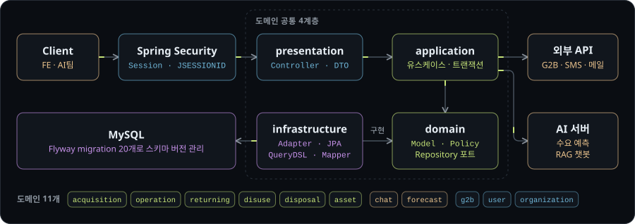

#### G2B 동기화 파이프라인

매일 00:10에 조달청 데이터를 Staging으로 받아 집합 단위로 병합합니다.

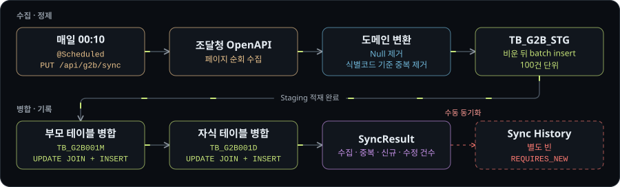

#### AI 수요 예측 파이프라인

AI 서버 응답을 그대로 믿지 않습니다. 상태 코드와 응답 내용을 모두 검사한 뒤에만 저장합니다.

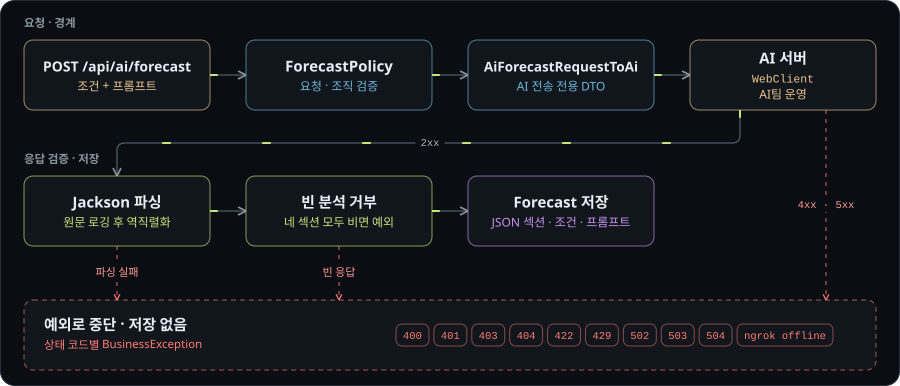

#### 자산 생애주기와 결재

취득, 운용, 반납, 불용, 처분의 모든 신청이 같은 결재 상태를 따릅니다.

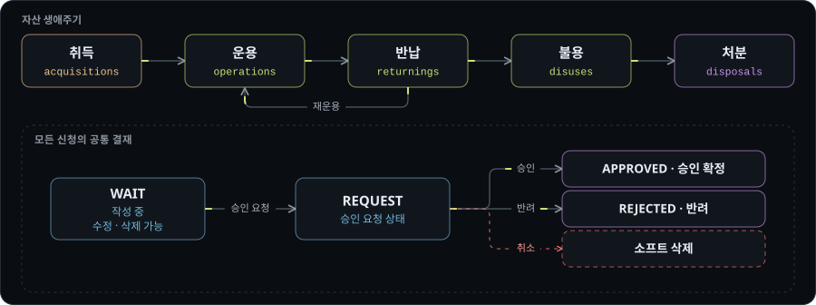

#### 설계 판단

| 문제 | 결정 | 코드 |
|---|---|---|
| 이력 기록이 호출자 트랜잭션에 묶임 | 이력 저장을 별도 빈의 `REQUIRES_NEW`로 분리. 같은 클래스 안에서 호출하면 프록시를 타지 않으므로 빈을 나눔 | [`G2bSyncHistoryApplication`](https://github.com/U-sto/U-sto_BE/blob/85e53c8b41bd2cebd85742b3aedbc3de6c28548f/src/main/java/com/usto/api/g2b/application/G2bSyncHistoryApplication.java#L18-L26) |
| 대량 반영을 건별 `save()`로 처리하기 어려움 | Staging에 적재한 뒤 네이티브 SQL로 집합 단위 병합 | [`G2bSyncApplication`](https://github.com/U-sto/U-sto_BE/blob/85e53c8b41bd2cebd85742b3aedbc3de6c28548f/src/main/java/com/usto/api/g2b/application/G2bSyncApplication.java#L55-L120) · [`SQL`](https://github.com/U-sto/U-sto_BE/blob/85e53c8b41bd2cebd85742b3aedbc3de6c28548f/src/main/java/com/usto/api/g2b/infrastructure/repository/G2bItemCategoryJpaRepository.java#L28-L51) |
| 공공 API에 당일 데이터가 아직 없음 | 조회 구간을 `now-2 ~ now-1`일로 고정 | [`syncDaily`](https://github.com/U-sto/U-sto_BE/blob/85e53c8b41bd2cebd85742b3aedbc3de6c28548f/src/main/java/com/usto/api/g2b/application/G2bSyncApplication.java#L47-L53) |
| 내부 DTO와 AI 스키마가 달라 422 발생 | AI 전송 전용 DTO로 분리 | [`AiForecastRequestToAi`](https://github.com/U-sto/U-sto_BE/blob/85e53c8b41bd2cebd85742b3aedbc3de6c28548f/src/main/java/com/usto/api/ai/forecast/presentation/dto/request/AiForecastRequestToAi.java) |
| 응답 섹션을 List로 가정해 Jackson `START_OBJECT` 오류 | 실제 응답 구조에 DTO를 맞추고, 원문을 남긴 뒤 파싱 | [`AiForecastAdapter`](https://github.com/U-sto/U-sto_BE/blob/85e53c8b41bd2cebd85742b3aedbc3de6c28548f/src/main/java/com/usto/api/ai/common/AiForecastAdapter.java#L97-L121) |
| AI 서버 장애의 원인을 구분할 수 없음 | 상태 코드별 예외 매핑, ngrok 오프라인 페이지 감지 | [`AiForecastAdapter`](https://github.com/U-sto/U-sto_BE/blob/85e53c8b41bd2cebd85742b3aedbc3de6c28548f/src/main/java/com/usto/api/ai/common/AiForecastAdapter.java#L31-L92) |
| 운영 서버 IP가 그대로 노출됨 | `api.` 도메인 분리, CORS와 credentials 정리, 조달청 허용 도메인 재등록 | [`CorsConfig`](https://github.com/U-sto/U-sto_BE/blob/85e53c8b41bd2cebd85742b3aedbc3de6c28548f/src/main/java/com/usto/api/common/config/CorsConfig.java#L17) |

### W브릿지

*여성과학기술인 AI 경력개발 솔루션 (WISET) · Qantum Edu Solution 인턴 · 소스 비공개*

**리포트 생성·저장·조회 · 후속 추천 · 레거시 이식.** AI 코칭·역량 진단 리포트와 멘토·컨설턴트 추천을 연결하는 기능을 개발하고 개선했습니다.

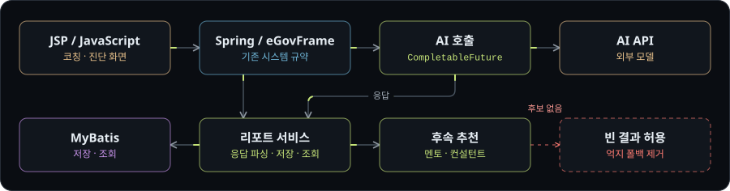

- AI 호출과 결과 저장의 책임을 나눴습니다.
- 추천 인원을 억지로 채우던 폴백을 없애고, 적합한 후보가 없으면 빈 결과를 허용했습니다.
- 후속 결과 대기 조건 때문에 종합의견 생성이 멈추던 결함을 고치고 회귀 시험으로 검증했습니다.
- 기존 전자정부프레임워크의 Java·MyBatis·JSP 규약에 맞춰 이식 구조와 화면을 정리했습니다.

### DOVIS

*포트폴리오 AI 에이전트 · v3.2 · 소스 비공개 · [parkdohyun.com](https://parkdohyun.com)에서 체험*

**AI 에이전트 설계 · 3D WebGL · 다계층 폴백.** 정적 포트폴리오 대신 질문에 답하는 에이전트를 만들었습니다. 단일 LLM API에 의존할 때 생기는 조용한 실패를 막으려고 응답 경로를 여러 겹으로 뒀습니다.

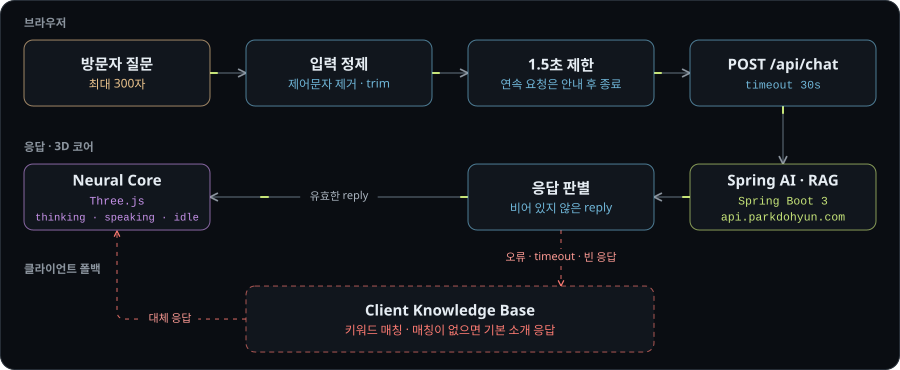

### Kids Friends

*키즈카페 안내 로봇 · 5인 팀 · 모바일로봇의이해 · [Organization](https://github.com/Kids-Friends) · [Demo Video](https://www.youtube.com/watch?v=tAUQZem72Ao&t=207s)*

**백엔드 API · 시스템 아키텍처 · 메시징 계약.** 직원이 안내와 호출 응대를 반복하느라 안전 관리에 집중하지 못하는 문제에서 출발했습니다. 센서가 도착하기 전에 이벤트 계약을 먼저 합의해 앱, 서버, 하드웨어 팀이 병렬로 개발했습니다.

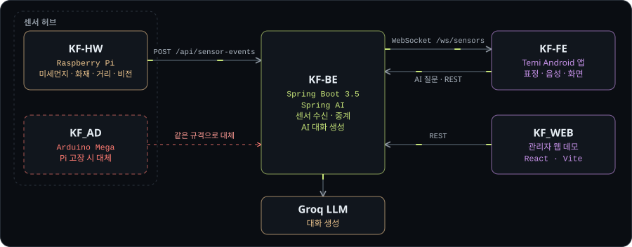

팀 사이의 계약은 이 한 줄입니다.

```json
{ "robotId": "TEMI_01", "eventType": "AIR_QUALITY", "payload": { "pm25": 23.0, "grade": "NORMAL" } }
```

### DOVERVE

*웹툰 플랫폼 · 개발 중 · 소스 비공개 · [doverve.com](https://doverve.com)*

**제품 기획 · 풀스택 · 콘텐츠 구조 설계.** 직접 만든 웹툰을 무료로 보는 플랫폼입니다. 작품 탐색, 회차 감상, 서재, 커뮤니티, 세계관 기반 미니게임을 구성했습니다.

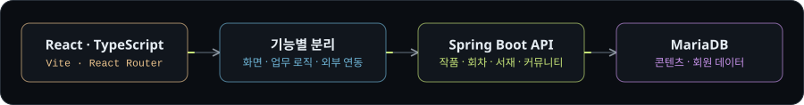

## How I Build

새 기능은 요구사항 요약에서 시작해 스키마, 코드, 검증 순서로 쌓습니다.

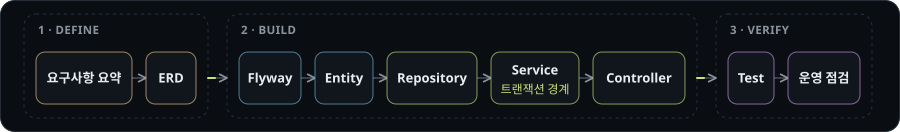

## Engineering Principles

| 원칙 | 의미 | 적용 |
|---|---|---|
| **문제에서 출발** | 기술보다 사용자가 반복해서 겪는 문제와 운영 흐름을 먼저 정의 | Kids Friends 현장 응대, DOVERVE 독자 흐름 |
| **Definition first** | 구두 합의 대신 API 명세, 스키마, 이벤트 정의서를 먼저 확정 | Kids Friends 센서 이벤트 |
| **기록은 업무와 분리** | 이력은 업무 트랜잭션과 별도로 커밋 | U-sto Sync History |
| **외부 결과는 경계에서 번역** | 외부 응답을 내부 예외와 도메인으로 바꾸고, 데이터 없음은 장애가 아닌 빈 결과로 처리 | U-sto G2B·AI 연동 |
| **AI는 검증 대상** | 파싱과 빈 응답 검사를 통과한 결과만 저장 | U-sto 수요 예측, W브릿지 리포트 |
| **좁혀 가는 디버깅** | 문제 재진술 → 가능 원인 2~3개 → 검증 명령 → 최소 수정 | 세션 인증의 쿠키·세션·인증 3단 로그 |

## Tech Stack

| Area | Stack |
|---|---|
| Backend |       |
| Database |    |
| Infra |    |
| AI |    |
| Frontend |     |
| IoT |    |

## Writing

- [Reading Capacity의 중요성, 책을 읽어라](https://parkdohyun.tistory.com/33)
- [리빙랩 수업을 공부하며 정리한 생각](https://parkdohyun.tistory.com/35)
- [AI가 정치를 할 수 없는 이유](https://parkdohyun.tistory.com/36)

<div align="center">

**AX Engineer · Product Builder · Product Engineer 기회와 협업 제안을 환영합니다.**

[badberg2002@gmail.com](mailto:badberg2002@gmail.com)

</div>
